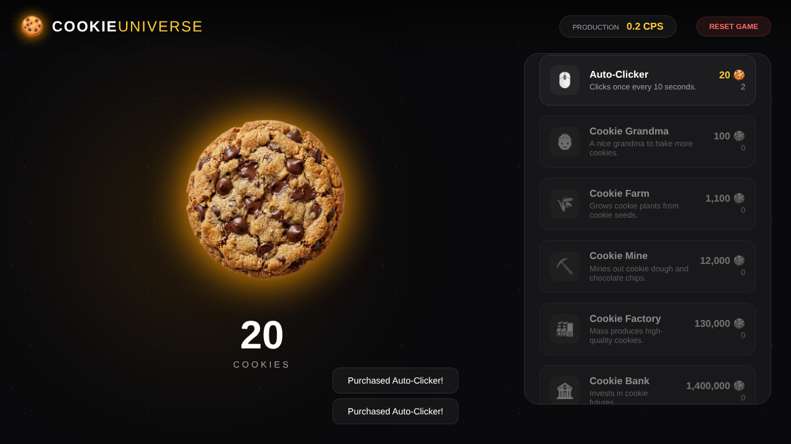

# 🍪 Cookie Universe

Jogo incremental (clicker) feito com JavaScript puro e Vite. Clique no cookie, compre geradores e melhorias e veja a produção crescer sozinha.

**▶ Jogar online:** https://henriquejorgemartinsfigueiredo.github.io/cookie/



## Funcionalidades

- Clique no cookie com efeito de partícula (+1)
- Loja com 6 geradores (Auto-Clicker, Grandma, Farm, Mine, Factory, Bank) e preço que sobe 15% a cada compra
- Melhorias que multiplicam a produção de um gerador
- Produção automática em cookies por segundo (CPS), atualizada 10 vezes por segundo
- Progresso salvo no navegador (`localStorage`) e botão para reiniciar
- Notificações (toasts) de compra

## Tecnologias

- HTML5, CSS3 (glassmorphism, animações) e JavaScript (ES Modules)
- [Vite](https://vitejs.dev/) para desenvolvimento e build
- GitHub Actions + GitHub Pages para publicar

## Como rodar

Requisito: Node.js 18 ou mais novo.

```bash
git clone https://github.com/HenriqueJorgeMartinsFigueiredo/cookie.git
cd cookie
npm install
npm run dev      # abre em http://localhost:5173
npm run build    # gera a versão final em dist/
```

## Estrutura

| Arquivo | O que faz |
|---|---|
| `index.html` | Estrutura da tela |
| `style.css` | Visual, animações e layout responsivo |
| `main.js` | Estado do jogo, loja, melhorias, loop de produção e salvamento |
| `.github/workflows/deploy.yml` | Build e publicação automática no GitHub Pages |

## Próximos passos

- Mais melhorias e conquistas
- Números grandes formatados (mil, milhão, bilhão)
- Versão em português

---

Feito por [Henrique Jorge](https://github.com/HenriqueJorgeMartinsFigueiredo).
